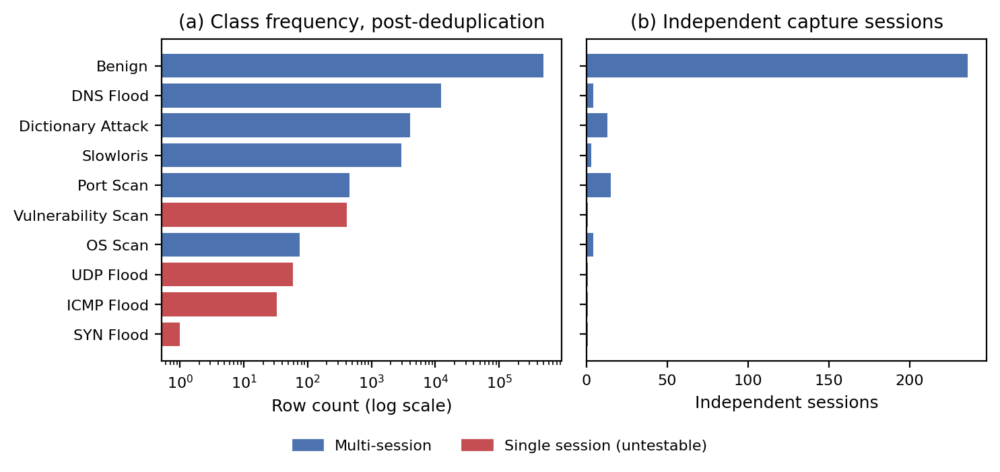
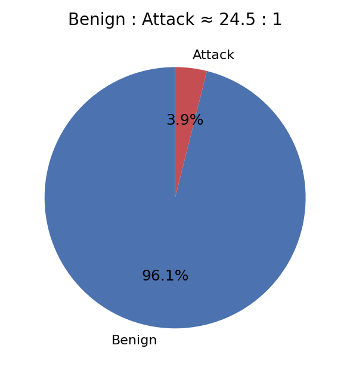
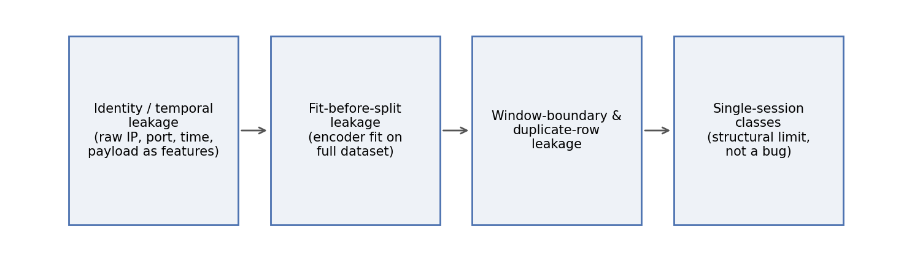
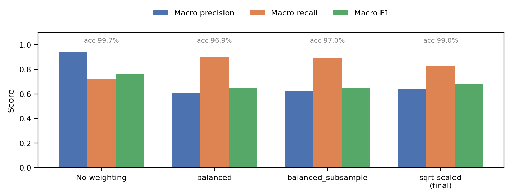
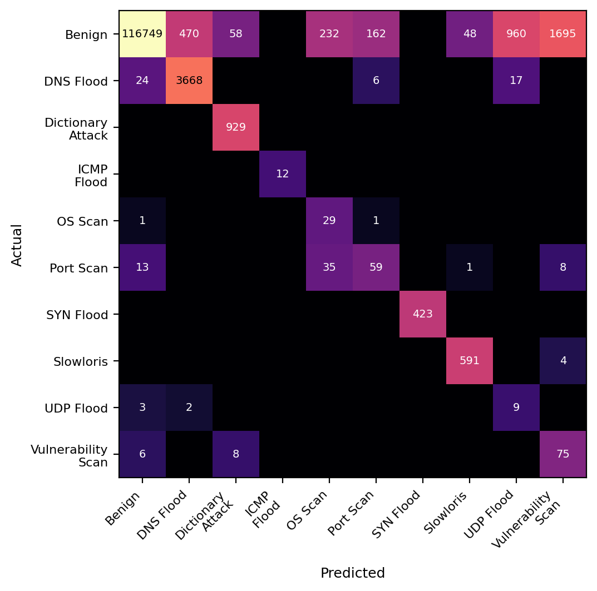
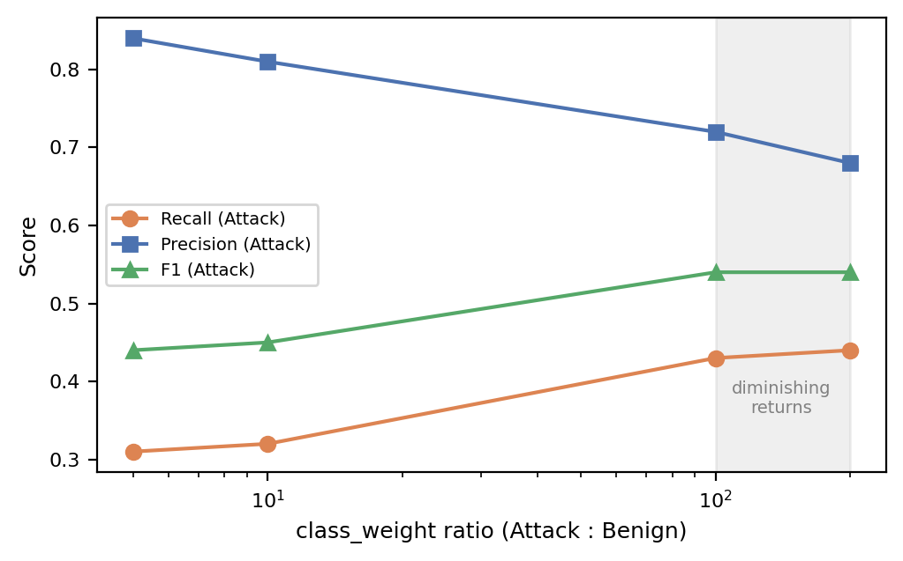
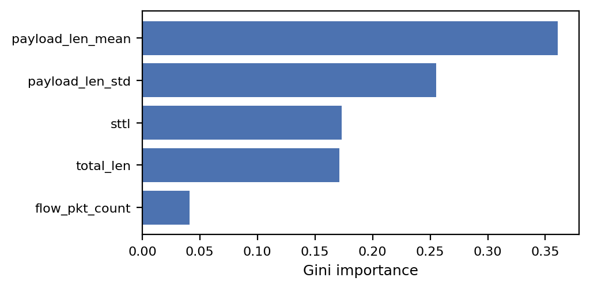
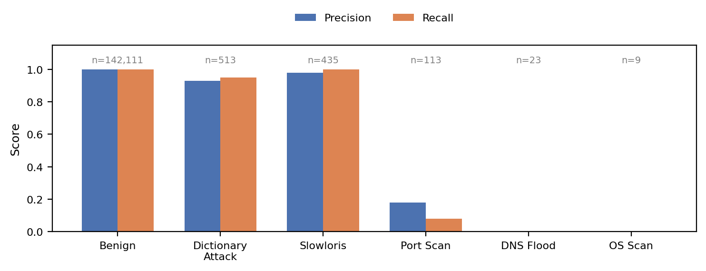

---
# Adjust field names to match your content collection schema (src/content.config.ts).
# Images are expected at src/assets/blog/iot-intrusion-detection/ (see README at the bottom of this file).
title: "99.97% Accuracy Was a Lie: Hunting Data Leakage in IoT Intrusion Detection"
description: "Two Random Forest architectures on the ACI-IoT-2023 dataset, four data-leakage bugs found and fixed along the way, and an honest account of which attacks this dataset can and cannot actually test."
pubDate: 2026-10-15
tags: ["machine-learning", "cybersecurity", "random-forest", "data-leakage", "iot", "scikit-learn", "fastapi"]
heroImage: "../../assets/blog/iot-intrusion-detection/fig8_leakage_timeline.png"
heroAlt: "Timeline of four data-leakage issues found during the project"
draft: false
---

> **TL;DR.** I trained Random Forests to detect attacks in IoT network traffic. The first notebook reported **99.97% accuracy**. It was almost entirely leakage. Fixing it took four rounds of debugging, each one uncovering a subtler leak than the last. The final, honest evaluation shows reliable detection for only **some** attack types, and proves that **four** of the ten classes cannot be evaluated at all with this dataset, no matter what model you use.
>
> Full two-column paper: [**download the PDF report**](/IoT_Intrusion_Detection_Technical_Report.pdf).

---

## 1. The problem

IoT devices get hit by floods, scans, and credential attacks constantly. Traffic-based intrusion detection frames this as supervised classification: given features of a packet or flow, predict whether it is benign or which attack it belongs to.

I used the [ACI-IoT-2023 dataset](https://www.kaggle.com/datasets/emilynack/aci-iot-network-traffic-dataset-2023/data), specifically the **payload-level** export (`ACI-IoT-2023-Payload.csv`). Each row is one packet with ten raw fields:

| Column | Kind | Meaning |
|---|---|---|
| `srcip`, `dstip` | identity | Source / destination IP |
| `sport`, `dsport` | identity | Source / destination port |
| `protocol_m` | categorical | Transport protocol |
| `sttl` | numeric | Source TTL |
| `total_len` | numeric | Packet length (bytes) |
| `stime` | numeric | Capture timestamp (epoch) |
| `payload` | raw hex | Packet payload content |
| `label` | target | Benign + 9 attack types |

The interesting part of this project turned out not to be model selection. It was **evaluation validity**.

---

## 2. Data exploration

### Severe imbalance, in two senses

After removing exact duplicates there are **499,147** Benign rows against **20,381** attack rows across nine categories, roughly **24.5 : 1**. Inside the attack classes the spread is far worse: DNS Flood has 12,397 rows, while SYN Flood collapses to a **single row** once duplicates are removed.





### The hidden structure: sessions

Row counts hide something more important. Splitting each class into **sessions** (contiguous bursts separated by gaps over 60 seconds) shows how the capture was actually generated:

| Class | Sessions | Rows (post-dedup) |
|---|---:|---:|
| Benign | 236 | 499,147 |
| Port Scan | 15 | 454 |
| Dictionary Attack | 13 | 3,989 |
| DNS Flood | 4 | 12,397 |
| OS Scan | 4 | 75 |
| Slowloris | 3 | 2,962 |
| **ICMP Flood** | **1** | 33 |
| **SYN Flood** | **1** | 1 |
| **UDP Flood** | **1** | 59 |
| **Vulnerability Scan** | **1** | 411 |

Four attack types were captured as **exactly one continuous burst**. Hold that thought, because it decides how much any accuracy number for those classes is worth.

### Which columns are safe to use?

Six of the ten columns (`srcip`, `dstip`, `sport`, `dsport`, `stime`, `payload`) are **identity or context fields**. They let a model memorize *where and when* a row came from instead of learning what attack traffic looks like. Only `protocol_m`, `sttl`, and `total_len` are reasonable direct per-packet features.

---

## 3. Four leaks, in the order I found them



### Leak 1: identity and temporal features

My first pipeline one-hot encoded **every** column, including IPs, ports, timestamp, and the raw hex payload. Attacks came from specific attacker machines during specific time windows, so the model could answer "attack" by recognizing an IP or a timestamp range. One-hot encoding the near-unique `payload` string acted like a row ID on top of that.

Result: **99.97% accuracy**, precision and recall of 1.00 almost everywhere. That is not a good model, that is memorization.

**Fix:** drop all six identity/context columns as model features (keep them only as grouping and sorting keys for feature engineering).

### Leak 2: fitting preprocessing before splitting

The encoder and scaler were fit on the full dataset **before** `train_test_split`, so test-set statistics leaked into preprocessing.

```python
# wrong: encoder has already seen the test rows
X_enc = preprocessor.fit_transform(X)
X_train, X_test, y_train, y_test = train_test_split(X_enc, y, ...)

# right: split first, fit on train only
X_train_enc = preprocessor.fit_transform(X_train)
X_test_enc  = preprocessor.transform(X_test)   # transform only, never fit
```

The same rule applies to `LabelEncoder` on the target.

### Leak 3: window-feature overlap and exact duplicates

To catch rate-based attacks I engineered time-window features per `(srcip, dstip)` pair over a trailing 5-second window: `flow_pkt_count`, `payload_len_mean`, `payload_len_std`. Two problems followed.

1. Rows near a train/test boundary had window statistics partly built from the other side of the split.
2. Flood and scan traffic is extremely repetitive. A direct audit found that **18,935 of 121,350 test rows (15.6%)** had an **exact feature-value twin** sitting in the training set.

```python
train_feat = df_train[feature_cols].drop_duplicates()
merged = df_test[feature_cols].merge(train_feat, how="inner")
print(f"{len(merged)} of {len(df_test)} test rows have an exact match in train")
```

**Fix:** deduplicate before splitting, then split by whole **sessions** rather than by an arbitrary time percentage. Sessions are separated by gaps over 60 s, far larger than the 5 s window, so no test row's window can reach back into training data.

```python
def assign_sessions(df, label_col="label", time_col="stime", gap=60):
    df = df.sort_values([label_col, time_col]).copy()
    df["session_id"] = (
        df.groupby(label_col)[time_col].diff().gt(gap)
          .groupby(df[label_col]).cumsum()
    )
    return df
```

### Leak 4 (really a limitation): single-session classes

Even after Leaks 1 to 3 were fixed, scores stayed suspiciously high. The session table above explains why. For ICMP Flood, SYN Flood, UDP Flood, and Vulnerability Scan there is only **one** execution of the attack in the entire dataset. Any train/test split of that class tests recognition of a later slice of the *same* burst, not detection of a *new* attack.

This is not a bug in the pipeline. It is a property of how the data was collected, and no split strategy can fix it. The honest move is to report those four classes as **not evaluable** instead of reporting a flattering number.

---

## 4. Solution 1: single-stage 10-class Random Forest

One `RandomForestClassifier` predicts all ten labels directly from `protocol_m` (one-hot) plus `sttl` and `total_len` (standardized).

### Class weighting: four strategies

With imbalance this extreme, how you weight classes dominates the result. I compared four options, including a custom **square-root-scaled** weight as a deliberately gentler version of full inverse-frequency weighting:

$$w_c = \sqrt{\frac{n_{\max}}{n_c}}$$



| Strategy | Accuracy | Macro P | Macro R | Macro F1 |
|---|---:|---:|---:|---:|
| None | 99.70% | 0.94 | 0.72 | 0.76 |
| `balanced` | 96.90% | 0.61 | 0.90 | 0.65 |
| `balanced_subsample` | 97.03% | 0.62 | 0.89 | 0.65 |
| **sqrt-scaled** | **98.98%** | **0.64** | **0.83** | **0.68** |

Unweighted training maximizes precision but largely ignores rare classes. Full `balanced` weighting does the opposite: it finds rare attacks but floods you with false alarms on Benign traffic. Sqrt scaling lands in a useful middle, and it had the best macro F1 of the four.



### Reading the confusion matrix

The pattern is telling. Attack types are almost never confused with **each other**. The errors are rare attacks (Port Scan, OS Scan, UDP Flood, Vulnerability Scan) being confused with **Benign**, and the reverse. Three per-packet features simply do not separate low-volume scan traffic from normal traffic, whatever the weighting.

---

## 5. Solution 2: two-stage cascade

If the hard part is Benign versus rare-attack, maybe the 10-way decision is too much to learn at once. So I split it:

- **Stage 1:** binary Random Forest, Benign vs Attack, using the engineered window features.
- **Stage 2:** multiclass Random Forest for attack subtype, trained **only** on true attack rows.

At inference, Stage 2 only sees rows Stage 1 flagged as Attack. That means evaluation has to be end-to-end: an attack that Stage 1 misses can never be rescued by Stage 2.

### Tuning Stage 1: where the ceiling is

I swept the Attack class weight over 5, 10, 100, and 200:



Recall nearly doubles from weight 10 to 100 (0.32 to 0.43), then barely moves from 100 to 200 (0.43 to 0.44) while precision keeps falling. That is the classic diminishing-returns shape: the bottleneck is no longer the weighting.

I then swept the decision threshold with `precision_recall_curve`, all the way down to a probability cutoff of 0.01. The best it could do was **0.52 recall at 0.30 precision**. So neither weight nor threshold can lift the ceiling. The features are the constraint.

### What the model actually relies on



The engineered rolling statistics `payload_len_mean` (0.361) and `payload_len_std` (0.255) dominate, ahead of the raw `sttl` and `total_len`. So the windowing step added real signal. Meanwhile `flow_pkt_count`, which I built specifically to catch flood *rate*, contributes just 0.041 at the binary level. Pooling very different attack types into one "Attack" class dilutes it. Three weak features (`protocol_m`, `sttl_std`, `unique_dsport_ratio`) were pruned with essentially no change in recall.

### The final, leak-free result

After fixing all four issues, here is the full cascade evaluated **only on classes with genuine multi-session held-out data**:



| Class | Precision | Recall | Test support |
|---|---:|---:|---:|
| Benign | 1.00 | 1.00 | 142,111 |
| Dictionary Attack | 0.93 | 0.95 | 513 |
| Slowloris | 0.98 | 1.00 | 435 |
| Port Scan | 0.18 | 0.08 | 113 |
| DNS Flood | 0.00 | 0.00 | 23 |
| OS Scan | 0.00 | 0.00 | 9 |

ICMP Flood, SYN Flood, UDP Flood, and Vulnerability Scan are **absent by construction**, because single-session classes contribute no held-out sessions. They are not failures, they are untestable.

Dictionary Attack and Slowloris, the two classes with the most multi-session support, hit F1 above 0.9. Port Scan is weak but non-zero. DNS Flood and OS Scan have multiple sessions yet still fail, which tells me the session fix repaired the **validity** of the evaluation, not the **volume** of data (23 and 9 test rows is thin).

---

## 6. Which solution is better?

| | Solution 1 | Solution 2 |
|---|---|---|
| Architecture | Single 10-class RF | Binary RF, then multiclass RF |
| Leakage audit | Partial | All four sources |
| Headline number | Macro F1 0.68 (sqrt-weighted) | Class-dependent |
| Classes evaluated | 10 (not verified) | 6 of 10 (verified) |
| Deployment | FastAPI app (deployed) | Notebook only |

Solution 1 looks stronger on paper, but I measured it **before** discovering the duplicate-row and session issues, so its numbers are very likely still partly inflated by the same leaks. Solution 2's numbers are lower, and they are the only ones I have verified against every leak I found. For the classes both can handle, trust Solution 2.

I deployed the single-stage Random Forest behind a FastAPI endpoint anyway. That is an engineering-simplicity call (one artifact, one inference call), not a claim that it is more accurate.

---

## 7. Limitations and what I would do next

- **Feature ceiling.** Benign-vs-Attack recall plateaus near 0.5 regardless of weighting or threshold. Flow-level features from the companion `ACI-IoT-2023.csv` (packet rate, distinct ports contacted, connection duration) are the most promising unexplored fix.
- **Data volume.** Four classes cannot be evaluated at all, and DNS Flood and OS Scan have too few multi-session test rows to learn from.
- **Re-audit Solution 1** against the dedup and session-split fixes before trusting its 98.98%.
- **Window size.** I only tried a 5 s window. 15 s or 30 s may capture slow scans better.

## 8. What I took away from this

1. **A very high score is a symptom to investigate, not a result to report.** Every leak here announced itself as "too good to be true."
2. **Leaks hide behind each other.** Fixing identity leakage exposed the preprocessing leak, which exposed duplicates, which exposed the session structure.
3. **Look at the data's generation process.** The single-session finding came from plotting *when* each class occurs, not from any model metric.
4. **Report what you cannot test.** Saying "these four classes are not evaluable" is more useful than a precise-looking number that measures nothing.

---

## Links

- **Full report (PDF):** [IoT_Intrusion_Detection_Technical_Report.pdf](/IoT_Intrusion_Detection_Technical_Report.pdf)
- **Dataset:** [ACI-IoT-2023 on Kaggle](https://www.kaggle.com/datasets/emilynack/aci-iot-network-traffic-dataset-2023/data)
- **GitHub:** [github.com/kleofr](https://github.com/kleofr)
- **Contact:** [morehimanish@gmail.com](mailto:morehimanish@gmail.com)
